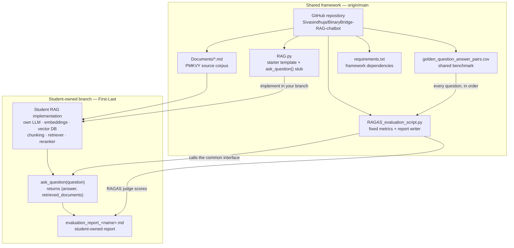

# BinaryBridge – Automated RAG Evaluation Framework

> A shared, reusable evaluation harness for student-built Retrieval-Augmented
> Generation (RAG) applications. BinaryBridge standardises **how** RAG systems
> are evaluated while leaving **how** they are built entirely to each student.

---

## Project Overview

In an educational cohort, every student builds a RAG application with a
different combination of LLM, embedding model, vector database, chunking
strategy, retriever, and reranker. Evaluating those systems by hand does not
scale: reviewers would need to ask the same questions repeatedly, judge answers
inconsistently, and inspect retrieved context manually. Results would not be
comparable across students.

BinaryBridge solves that problem with three pieces:

1. **A standard interface.** Every student implementation exposes the same
   `ask_question(question)` function, returning an answer and the documents that
   were retrieved.
2. **A shared golden dataset.** All students are measured against the same
   manually validated question–answer pairs, so scores are comparable and
   regressions are visible.
3. **An automated RAGAS harness.** The evaluation script runs every question
   against the checked-out implementation, computes the same four metrics, and
   writes an individual Markdown report.

The framework deliberately does **not** prescribe a single RAG architecture.
Students are free to use LangChain, LlamaIndex, plain Python, a hosted vector
database, a local index, hybrid search, reranking, or any other approach. The
evaluation harness only depends on the `ask_question()` contract. This preserves
the educational goal: students learn by making and measuring their own design
decisions.

> **Scope note:** This repository is an evaluation framework and starter
> template. `RAG.py` on `main` is intentionally a stub, not a finished PMKVY
> chatbot. Each student branch contains that student's implementation and
> report.

---

## Architecture



**Shared framework:** the repository scaffold, golden dataset, evaluation
script, dependency file, and documentation on `main`.

**Student implementation:** everything inside `RAG.py` on a personal branch,
including the choice of LLM, embeddings, vector store, chunking, retrieval, and
reranking. The student also owns the generated evaluation report.

The harness does **not** discover or iterate over GitHub branches. Each student
runs the script locally against their own checked-out `RAG.py`.

---

## Student Workflow

### 1. Clone the repository

```bash
git clone https://github.com/Sivasindhuja/BinaryBridge-RAG-chatbot.git

cd BinaryBridge-RAG-chatbot
```

### 2. Create your personal branch

```bash
git checkout -b First-Last
```

For example:

```bash
git checkout -b John-Doe
```

**Never push directly to `main`.** All student work belongs on a personal
branch.

### 3. Install the framework dependencies

```bash
pip install -r requirements.txt
```

The pinned packages in `requirements.txt` cover the starter template and the
RAGAS harness. If your implementation uses additional technologies (for
example, ChromaDB, FAISS, Groq, or OpenAI), add those to your own environment.
They are not imposed on every student.

### 4. Implement your RAG pipeline in `RAG.py`

Complete the ingestion, chunking, vector-store, retrieval, and generation
functions in `RAG.py`. You may replace the starter code with your own structure
as long as the public interface below is preserved.

### Required interface

```python
def ask_question(question: str):
    """
    Returns:
        tuple:
            answer: str
            retrieved_documents: List[Document]
    """
```

- `answer` must be a string.
- `retrieved_documents` must be a list (or tuple) of documents.
- Every retrieved document must expose `page_content`; the harness uses
  `doc.page_content` to extract the context passed to RAGAS.
- Returning an empty context list is allowed, but context-based metrics may be
  unavailable for that question. The report records this rather than inventing
  a score.

Students using another framework (LlamaIndex, a custom dataclass, a hosted
vector store, etc.) should adapt their output to this interface. A plain list of
strings is tolerated for convenience, but LangChain-style `Document` objects
with `page_content` are the documented contract.

### 5. Configure the evaluation model

Create a `.env` file in the repository root (never commit it):

```env
GEMINI_API_KEY=your_gemini_api_key_here
```

`GOOGLE_API_KEY` is also accepted. The key is used only by the RAGAS judge; it
is never printed in logs or reports.

### 6. Run the evaluation

See [Running Evaluation](#running-evaluation) below.

### 7. Commit your implementation and report

```bash
git add RAG.py evaluation_report_<your-name>.md
git commit -m "Completed RAG pipeline and evaluation"
git push origin First-Last
```

Open a pull request from your personal branch into `main`. Do not merge your own
PR unless the instructor asks you to.

---

## Golden Dataset

`golden_question_answer_pairs.csv` is the shared benchmark. It currently
contains **68 manually validated question–answer pairs** based on the PMKVY
source documents in `Documents/`. (Some earlier documentation referred to 69
pairs; the csv in this repository has 68 data rows. The evaluator always reads
the actual row count rather than hardcoding a number.)

The dataset includes:

- **Factual questions** — eligibility, benefits, RPL types, insurance, target
  groups, fees, and other details stated directly in the source documents.
- **Comparative questions** — for example, age limits or requirements across
  STT and RPL.
- **Unanswerable questions** — topics that the supplied corpus does not cover.
- **Missing-information questions** — questions where the documents contain
  only part of the requested information.
- **Out-of-scope questions** — unrelated topics that a grounded system should
  decline or mark as outside the corpus.
- **Adversarial and prompt-injection questions** — requests to ignore the
  documents, invent facts, or pretend a policy says something it does not say.

The dataset gives every student the same reference point. Reference answers
must not be edited merely to make a particular implementation score better.
Changes to the benchmark should be reviewed separately and applied to `main` so
that every branch is measured against the same version.

---

## Evaluation Metrics

The harness computes four RAGAS metrics:

| Metric | What it assesses |
|---|---|
| **Faithfulness** | Whether the claims in the generated answer are supported by the retrieved context. Low scores suggest hallucination or unsupported additions. |
| **Answer Correctness** | How well the generated answer agrees with the reference answer, combining factual overlap and semantic similarity. |
| **Context Precision** | Whether the retrieved chunks that are relevant to the reference answer are ranked ahead of less relevant chunks. |
| **Context Recall** | How much of the information needed by the reference answer is present in the retrieved context. |

All four are calculated by RAGAS using the Gemini judge and HuggingFace
`sentence-transformers/all-MiniLM-L6-v2` embeddings configured in
`RAGAS_evaluation_script.py`. Averages are computed only from valid metric
values; missing or failed values are reported as `N/A`.

### Important limitations

- **Citation accuracy is not independently measured.** The harness does not
  validate that an answer's citations or source metadata are correct. It scores
  answer text and context text only.
- **Refusal quality is not a separate metric.** The dataset contains
  unanswerable, out-of-scope, and adversarial questions, but the four metrics
  above do not include a dedicated refusal-detection or prompt-injection
  classifier. Those questions still contribute through Faithfulness, Answer
  Correctness, Context Precision, and Context Recall.
- **Retrieval quality is judged against the reference answer**, not against a
  human relevance label for every chunk.

These limitations are stated explicitly so that a high aggregate score is not
misread as proof of citation correctness or robust refusal behaviour.

---

## Running Evaluation

From the repository root, with your implementation in `RAG.py`:

```bash
pip install -r requirements.txt
python RAGAS_evaluation_script.py
```

The script:

1. loads and validates `golden_question_answer_pairs.csv`;
2. prompts for your first and last name;
3. calls your `ask_question()` for **every** row, in dataset order;
4. records generation failures and continues with the remaining questions;
5. scores successful answers with RAGAS;
6. writes `evaluation_report_<your-name>.md`;
7. prints whether the evaluation was complete or incomplete.

A full run makes many paid LLM calls and can take several minutes. The harness
uses one worker and a short delay between questions to reduce rate-limit errors.

The default judge model is `models/gemini-2.0-flash`. To use a different Gemini
model, set `EVAL_LLM_MODEL` in `.env` (for example,
`EVAL_LLM_MODEL=models/gemini-2.5-flash`).

**Exit codes:** `0` means the evaluation completed with all questions and metric
values available; `2` means a report was written but the evaluation was
incomplete; `1` means a configuration/dataset problem prevented a report from
being written.

### Offline harness checks

The maintenance test suite mocks all LLM and embedding calls, so it can be run
without credentials or paid API usage:

```bash
pip install pytest
python -m pytest tests -q
```

---

## Evaluation Report

Each student commits an individual report generated from their own run. The
report structure is:

```markdown
# RAG Evaluation Report: Student Name

## Evaluation Summary

- Total test cases: <count>
- Successful (answer generated): <count>
- Failed (answer generation): <count>
- Questions with complete metric results: <count>
- Evaluation status: <COMPLETE or INCOMPLETE with reasons>

## Aggregate Metrics

| Metric | Score | Valid results |
|---|---|---|
| Faithfulness | <score or N/A> | <valid>/<total> |
| Answer Correctness | <score or N/A> | <valid>/<total> |
| Context Precision | <score or N/A> | <valid>/<total> |
| Context Recall | <score or N/A> | <valid>/<total> |

## Detailed Results

| # | Question | Faithfulness | Answer Correctness | Context Precision | Context Recall |
|---|---|---|---|---|---|
| <n> | <question> | <score or N/A> | <score or N/A> | <score or N/A> | <score or N/A> |

## Failed Questions

<question numbers and error messages, or "None">

### Missing metric values

<questions and metrics that RAGAS could not score, or "None">

## Student Summary

<student's analysis: strengths, weaknesses, retrieval/chunking choices, next steps>
```

The placeholders above show structure only; they are not example scores. Actual
reports contain the metrics produced by the student's run. Failed questions are
listed with their error messages, and missing metric values are never replaced
with artificial zeros.

---

## Repository Structure

```text
BinaryBridge-RAG-chatbot/
├── Documents/
│   ├── PMKVY_RPL.md
│   ├── PMKVY_Special_Projects.md
│   └── PMKVY_STT_Scheme.md
├── RAG.py                            # starter template; implement here
├── RAGAS_evaluation_script.py        # shared evaluation harness
├── golden_question_answer_pairs.csv  # shared benchmark (68 Q/A pairs)
├── requirements.txt                  # mandatory framework dependencies
├── instructions.md                   # assignment brief
├── README.md
├── .gitignore                        # protects .env; keeps reports commit-able
└── evaluation_report_<name>.md       # generated on each student branch
```

**Local-only files** (never committed): `.env`, virtual environments, local
vector-database directories, and logs.

The shared starter files above live on `main`. On a student branch, `RAG.py` is
replaced by that student's implementation and an individual
`evaluation_report_<name>.md` is added.

---

## Contribution Guidelines

### Branch workflow

1. Create a personal branch named `First-Last`:

   ```bash
   git checkout -b First-Last
   ```

2. Implement your pipeline only in `RAG.py` (you may add supporting files if
   your design needs them, but keep the `ask_question()` interface intact).
3. Run the evaluator locally against your checked-out implementation.
4. Commit both your implementation and your generated report:

   ```bash
   git add RAG.py evaluation_report_<your-name>.md
   git commit -m "Completed RAG pipeline and evaluation"
   git push origin First-Last
   ```

5. Open a pull request targeting `main`. Do not push to `main` directly and do
   not modify another student's branch or report.

### What not to do

- Do not commit `.env`, API keys, virtual environments, or generated vector
  database directories.
- Do not edit the golden reference answers to improve a score.
- Do not commit another student's implementation or evaluation report.
- Do not assume the evaluator scans all branches. It evaluates only the
  `RAG.py` currently checked out in your working directory.
- Do not treat a partially completed run as a full evaluation. Check the report's
  Evaluation Summary and Failed Questions section.

### Changes to the shared framework

Documentation, harness, and dataset changes belong on a separate maintenance
branch and pull request. They should keep the `ask_question()` contract stable
and must not alter student branches.

---

## License

**No `LICENSE` file is currently present in this repository.** The repository
should therefore not be assumed to be MIT-licensed or otherwise open for
redistribution. The previous README displayed an MIT badge without a
corresponding license file. Please confirm the intended license with the
repository owner before adding one or reusing the code outside this course.

The PMKVY scheme documents in `Documents/` remain the property of the Ministry
of Skill Development & Entrepreneurship (MSDE) / Government of India and are
included here for educational use.

---

## Acknowledgments

- Ministry of Skill Development & Entrepreneurship (MSDE) / NSDC for the PMKVY
  source documents
- The LangChain, RAGAS, HuggingFace, and `sentence-transformers` communities
- The BinaryBridge cohort, whose varied implementations motivated a
  standardised, implementation-agnostic evaluation process
